# Post-contenido Unidad 11 — Refactorización guiada por pruebas
**Asignatura:** Patrones de Diseño de Software  
**Proyecto:** `refactoring-u11`  


## Objetivo

Identificar dos problemas de diseño (*Long Method* y *Switch Statements* duplicados), proteger el comportamiento original con pruebas de caracterización y eliminarlos mediante refactorizaciones verificadas con las mismas pruebas. Todo el trabajo corresponde a la **Parte 1** de la Unidad 11; la Parte 2 se añadirá posteriormente a este mismo repositorio.

## Parte 1 — Red de seguridad y refactorización

### Paso 1. Proyecto y diagnóstico del código original

Se creó un proyecto Spring Boot con Maven, Java 17 y el paquete base `com.universidad.refactoringu11`. Se implementó el paquete `inventario`, con `Producto`, `TipoProducto`, `InventarioService`, `ClasificadorProducto` y `EtiquetadoProducto`.

**Estructura inicial:**

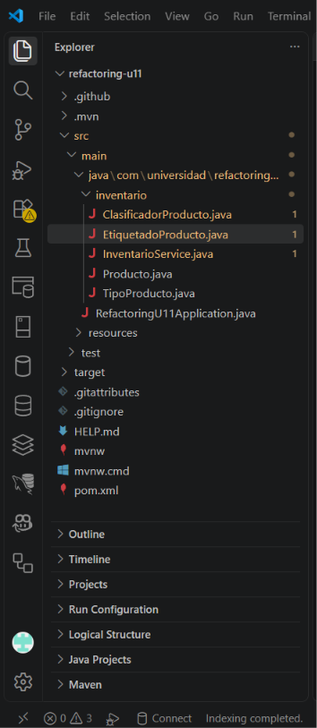

**Comprobación de compilación:** el código original compila sin errores mediante `mvn compile`.

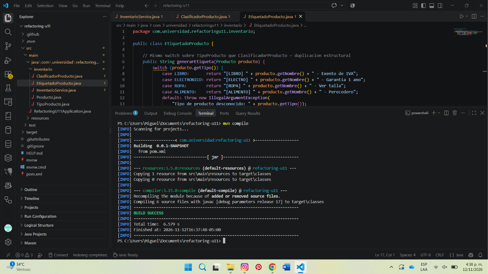

**Code Smell 1 — Long Method.** El método `InventarioService.actualizarInventario()` contiene cinco grupos de responsabilidades: validar los datos, buscar el producto, calcular y actualizar el stock, calcular el reorden, y registrar el movimiento y emitir alertas. En el código original proporcionado en la guía, el método ocupa **44 líneas físicas** (incluidas la declaración, llave de cierre, líneas vacías y comentarios), de las cuales **38 no están vacías**. Esta medida se refiere al código original de la guía; si el formato del archivo local es diferente, debe prevalecer la medición real.

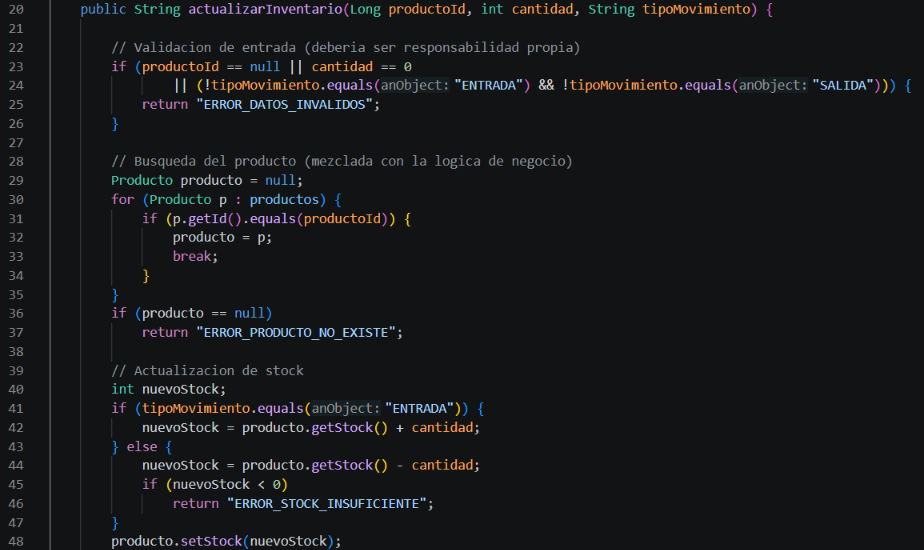

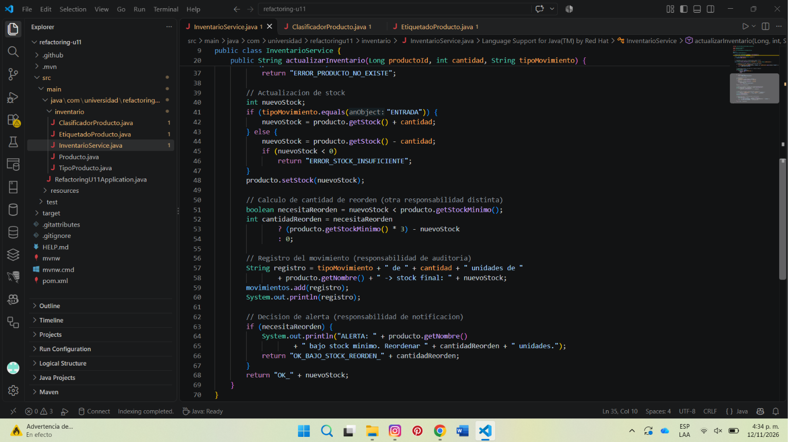

**Code Smell 2 — Switch Statements duplicados.** `ClasificadorProducto` y `EtiquetadoProducto` repiten un `switch` sobre los cuatro valores de `TipoProducto` (`LIBRO`, `ELECTRONICO`, `ROPA`, `ALIMENTO`). Hay **2 switches** y **8 ramas `case`** en total. La duplicación obliga a editar ambas clases cuando se incorpora un tipo nuevo.

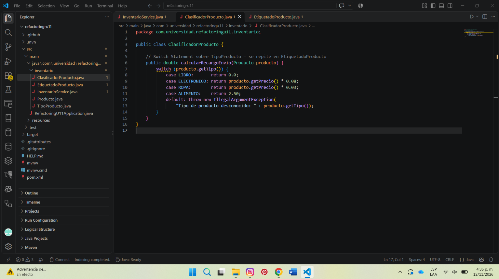

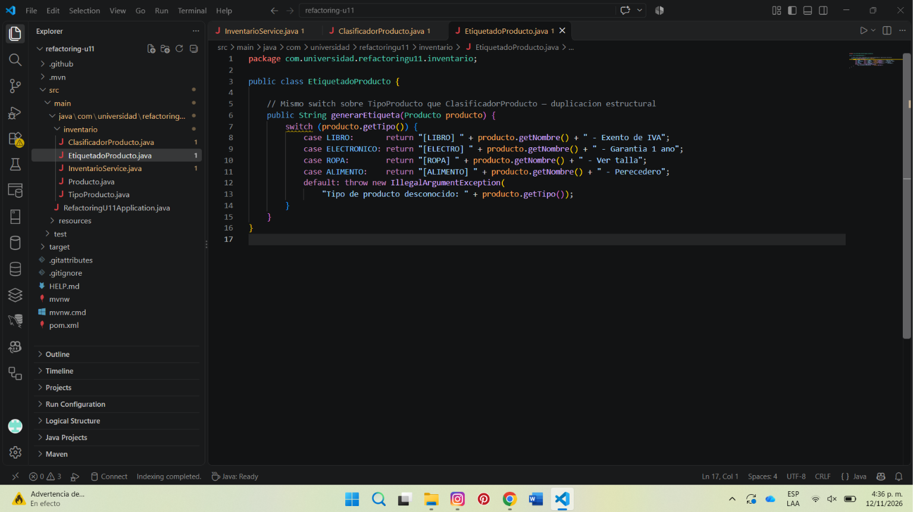

### Paso 2. Pruebas de caracterización antes de refactorizar

Antes de cambiar el código de producción, se crearon pruebas JUnit 5 que ejecutan las clases directamente, sin iniciar el contexto de Spring. Las pruebas documentan entradas, salidas, errores de inventario, cálculo de reorden, recargos y etiquetas.

| Clase | Casos del enunciado | Ampliación recomendada |
|---|---:|---:|
| `InventarioServiceTest` | 6 | 6 |
| `ClasificadorProductoTest` | 4 | 4 |
| `EtiquetadoProductoTest` | 2 | 4, incluyendo ROPA y ALIMENTO |
| **Total** | **12** | **14** |

**Cantidad realmente ejecutada:** 15.

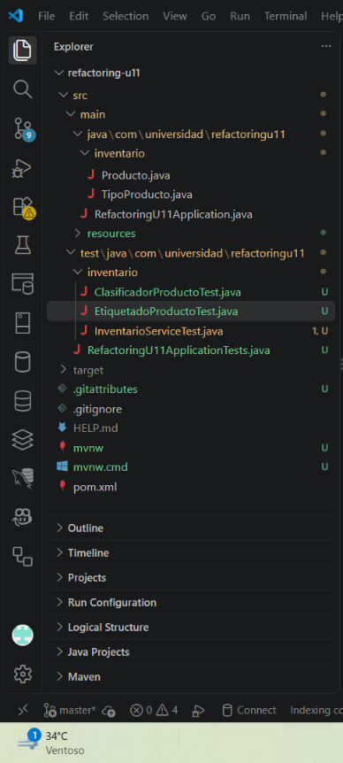

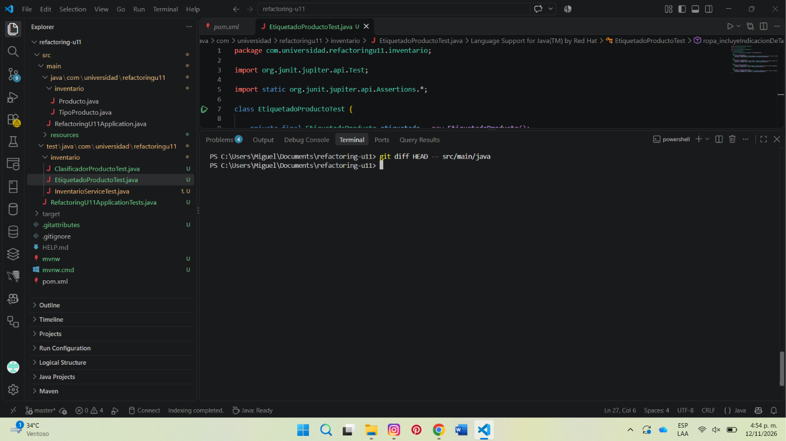

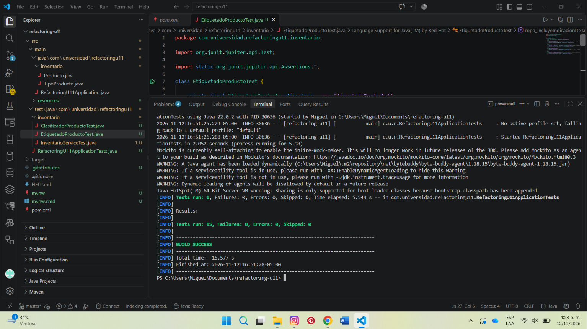

Estas pruebas se registraron en Git **antes** de realizar cualquiera de las dos refactorizaciones.

### Paso 3. Refactorización del Long Method

**Técnica elegida:** *Extract Method* (extraer método), del catálogo de Martin Fowler.

`actualizarInventario()` queda como método coordinador y delega en `datosValidos`, `buscarProducto` y `procesarMovimiento`. Este último organiza las llamadas a `calcularNuevoStock`, `calcularCantidadReorden`, `registrarMovimiento` y `generarResultado`. Las fórmulas, condiciones de retorno y mensajes del código original se conservaron.

| Indicador | Antes | Después |
|---|---:|---:|
| Líneas físicas de `actualizarInventario()`* | 44 | 6 |
| Grupos de responsabilidades implementados directamente | 5 | Coordinación y delegación |
| Métodos privados de apoyo | 0 | 7 |
| Pruebas originales modificadas | — | 0 |


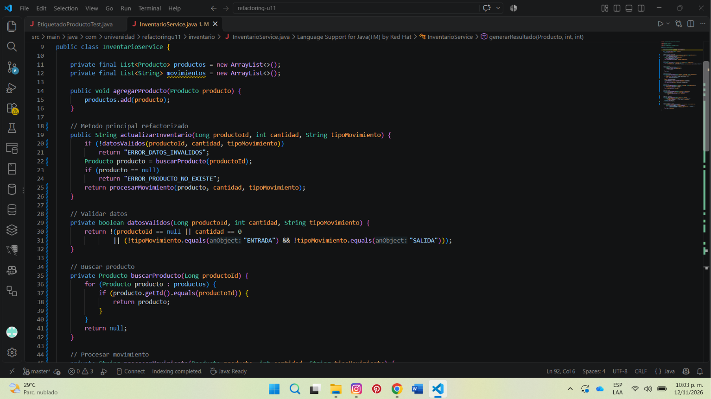

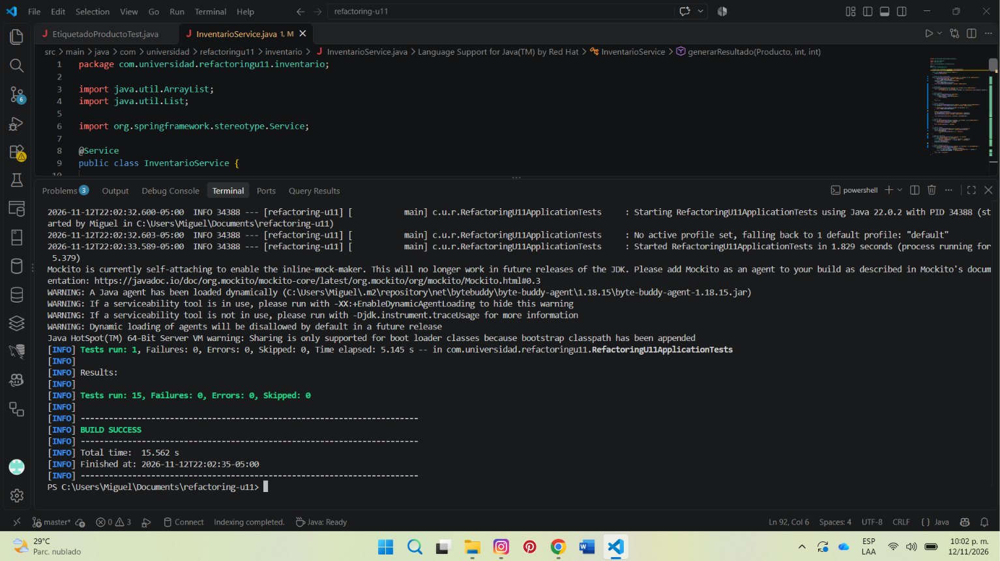

#### Decisión de diseño 1 — ¿Método privado o clase CalculadoraReorden?

**Se eligió mantener `calcularCantidadReorden()` como método privado de `InventarioService`.** La fórmula depende únicamente del stock disponible y del stock mínimo, es simple y no utiliza dependencias externas. En el dominio actual no existen distintas políticas de reorden que justifiquen una clase colaboradora independiente. Extraer una clase ahora aumentaría la cantidad de componentes sin un beneficio proporcional. Si aparecen reglas distintas por proveedor, categoría o temporada, será oportuno crear una clase especializada.

### Paso 4. Eliminación del Switch Statement duplicado

**Técnica elegida:** *Replace Conditional with Polymorphism* (reemplazar condicional con polimorfismo).

Los dos `switch` se sustituyeron por comportamiento polimórfico en `TipoProducto`: cada constante del `enum` implementa `calcularRecargoEnvio(double)` y `generarEtiqueta(String)`. Las clases `ClasificadorProducto` y `EtiquetadoProducto` delegan en el `enum`, **sin modificar las firmas públicas originales**.

**Antes de la refactorización:**

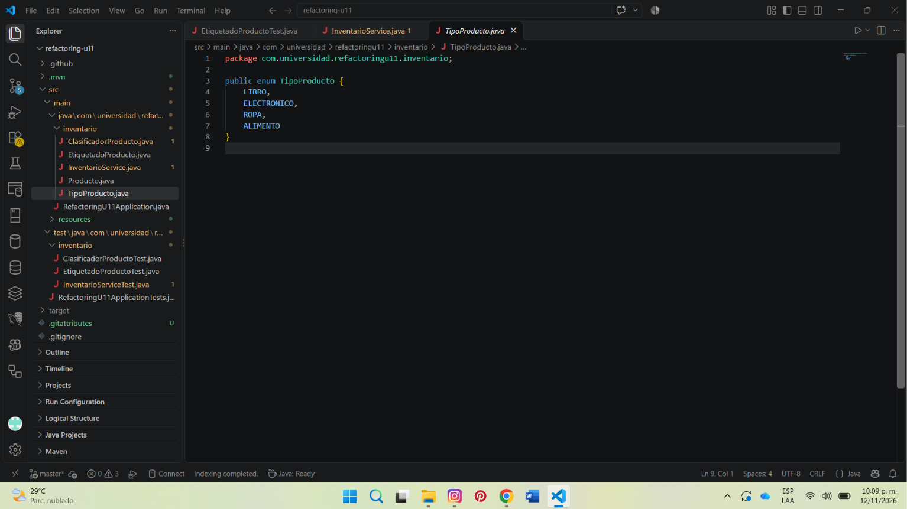

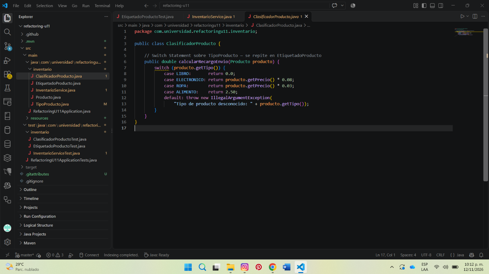

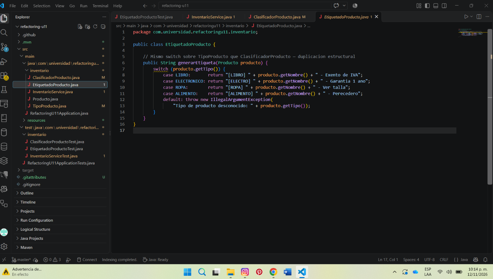

**Después de la refactorización:**

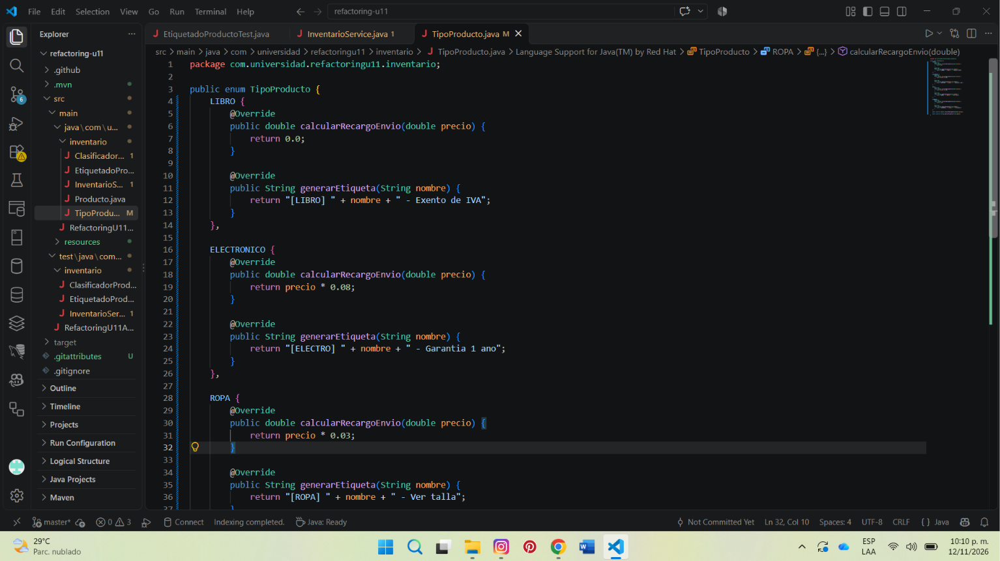

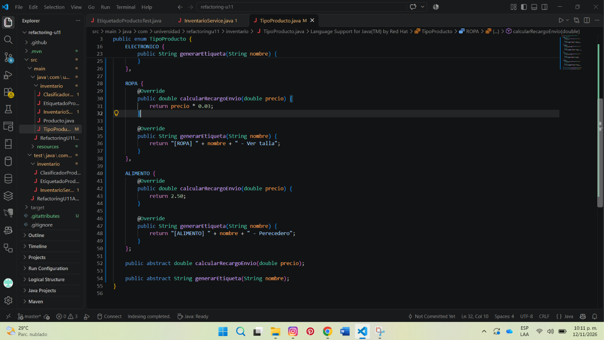

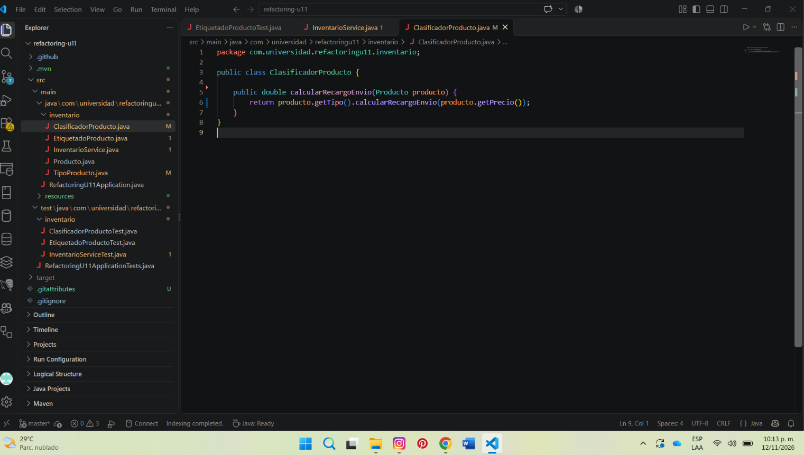

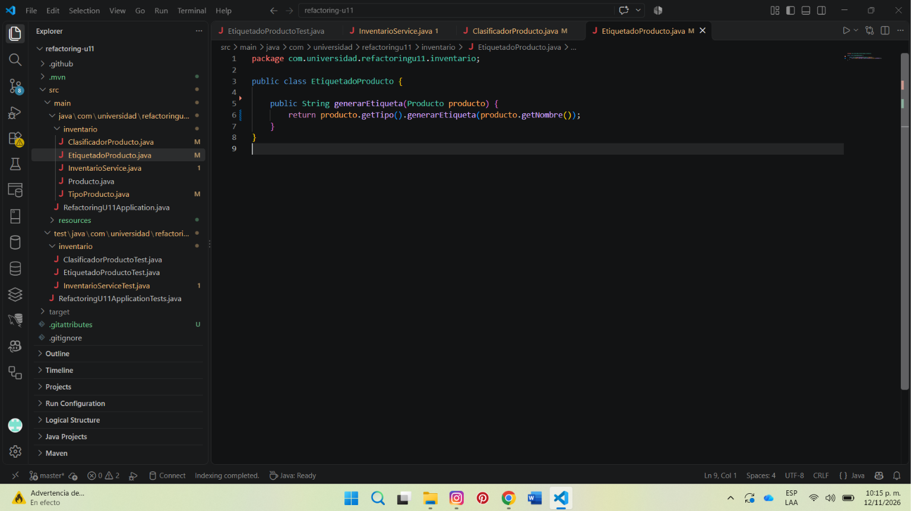

| Indicador | Antes | Después |
|---|---:|---:|
| Switches sobre `TipoProducto` en las dos clases | 2 | 0 |
| Ramas `case` en esos switches | 8 | 0 |
| Cambios necesarios en `ClasificadorProducto` y `EtiquetadoProducto` al añadir un tipo | 2 clases | 0 clases |
| Firmas públicas conservadas | 2 | 2 |

**Evidencia de regresión:**

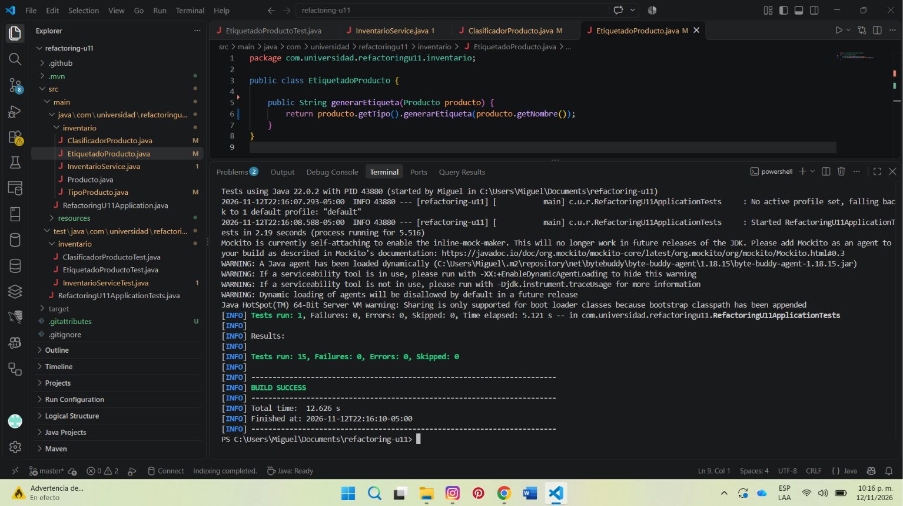

#### Decisión de diseño 2 — ¿Enum polimórfico o interfaz Strategy?

**Se eligió un `enum` con métodos abstractos implementados por cada constante.** Los cuatro tipos forman un conjunto cerrado y estable; sus reglas de recargo y etiquetado son sencillas y no necesitan servicios externos. Esta alternativa evita crear una interfaz y varias clases de estrategia, y permite añadir un tipo sin modificar las clases cliente. Si cada tipo necesitara dependencias inyectadas por Spring, configuración dinámica o algoritmos más complejos, sería preferible utilizar estrategias independientes.

### Paso 5. Consolidación de la evidencia y primer push

Las capturas se encuentran en `docs/parte1/` y están insertadas en el README **inmediatamente después de la explicación que respaldan**. El historial de commits permite verificar el orden de trabajo: código original, pruebas de caracterización, refactorización del Long Method, refactorización de los switches y documentación.

**Resultados de Maven por etapa:**

| Momento | Evidencia | Resultado |
|---|---|---|
| Código original | `01-mvn-compile-success.png` | `BUILD SUCCESS` en `mvn compile` |
| Pruebas antes de refactorizar | `02-pruebas-caracterizacion-verde.png` | Pruebas verdes; registrar cantidad exacta de Maven |
| Después de extraer métodos | `03-pruebas-en-verde-después-de-refactorizar-el-metodo.png` | Pruebas verdes; misma batería de caracterización |
| Después del polimorfismo | `04-pruebas-polimorfismo-verde.png` | Pruebas verdes; misma batería de caracterización |

## Parte 2. Diagnóstico y resolución de acoplamiento entre paquetes

### Paso 1. Incorporación del módulo de reportes

Se incorporó el paquete `reportes` al proyecto existente, implementando la clase `ReporteBajoStockService`, encargada de consultar los productos registrados en el inventario y generar un reporte de aquellos cuyo stock se encuentra por debajo del mínimo establecido.

Para integrar ambos módulos, se extendió `InventarioService` mediante un colaborador opcional configurado por setter, conservando su constructor implícito sin argumentos y la compatibilidad con las pruebas de caracterización de la Parte 1.

#### 1.1. Estructura del módulo de reportes

Se creó el paquete `reportes` dentro de `com.universidad.refactoringu11`, manteniendo el paquete `inventario` desarrollado anteriormente.

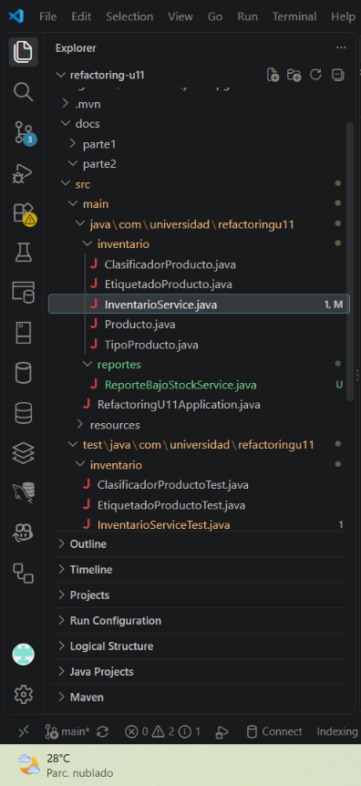

#### 1.2. Implementación de ReporteBajoStockService

Se implementó el método `generarReporte()`, que consulta los productos disponibles y construye un reporte de texto con aquellos cuyo stock es inferior al mínimo definido.

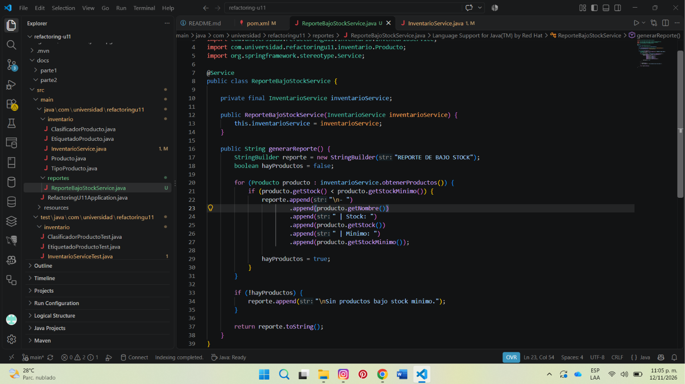

#### 1.3. Introducción intencional del acoplamiento

La integración genera dependencias entre los paquetes en ambas direcciones:

- **inventario → reportes:** `InventarioService` utiliza `ReporteBajoStockService` para generar reportes cuando se detecta una condición de bajo stock.
- **reportes → inventario:** `ReporteBajoStockService` utiliza `InventarioService` y `Producto` para consultar la información del inventario.

Esta estructura introduce intencionalmente un ciclo de dependencias que será diagnosticado mediante ArchUnit.

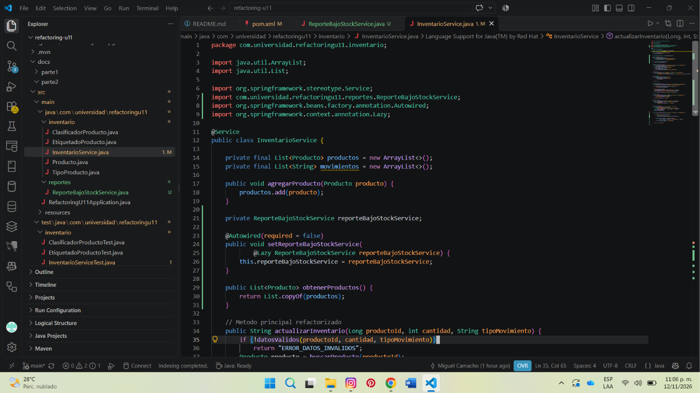

#### 1.4. Verificación funcional

Se ejecutó `mvn test` después de incorporar el módulo de reportes, utilizando las pruebas de caracterización de la Parte 1 sin modificarlas.

La evidencia muestra la ejecución satisfactoria de las pruebas, lo que permite comprobar que la integración no alteró los comportamientos verificados previamente.

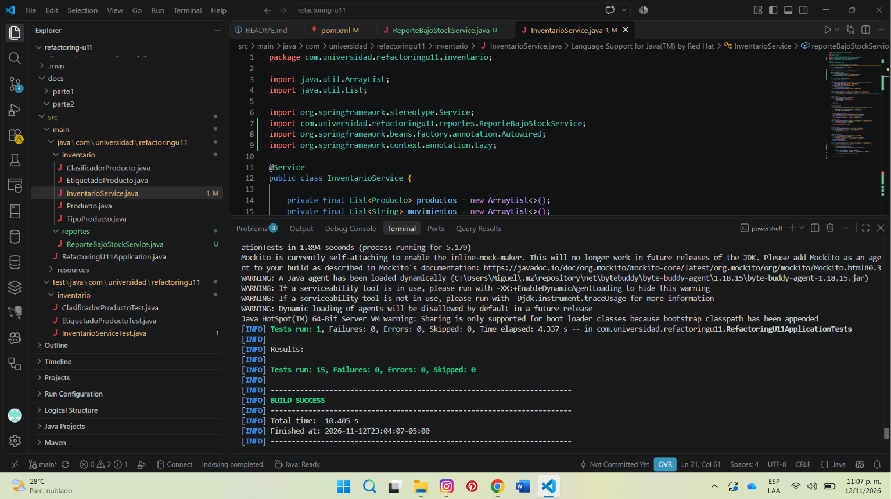

### Paso 2. Diagnóstico del acoplamiento mediante ArchUnit

Se implementó `ArquitecturaPaquetesTest` utilizando ArchUnit 1.3.0, con el objetivo de identificar dependencias cíclicas entre los paquetes del proyecto.

La prueba utiliza la regla `beFreeOfCycles()` para verificar que los paquetes no formen ciclos de dependencia.

#### 2.1. Implementación de la prueba de arquitectura

Se creó `ArquitecturaPaquetesTest.java` dentro de `src/test/java/com/universidad/refactoringu11/`.

Esta prueba analiza las dependencias entre los paquetes del proyecto sin modificar las clases de producción.

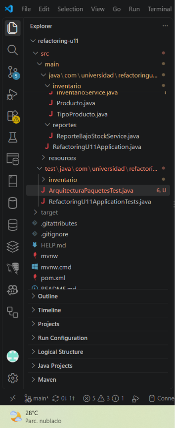

#### 2.2. Diagnóstico de la dependencia cíclica

El diseño incorporado presenta las siguientes dependencias:

- `inventario → reportes`: `InventarioService` importa `ReporteBajoStockService`.
- `reportes → inventario`: `ReporteBajoStockService` importa `InventarioService` y `Producto`.

Estas dependencias forman un ciclo entre paquetes, debido a que ambos requieren conocer elementos del otro.

**Diagrama de arquitectura antes de la corrección:**

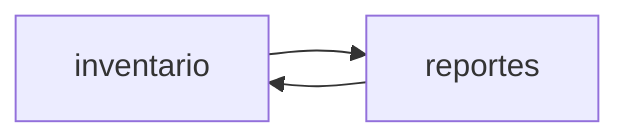

El acoplamiento bidireccional dificulta la evolución independiente de los módulos y evidencia un problema de diseño que no necesariamente se manifiesta mediante errores funcionales.

#### 2.3. Ejecución de la prueba de arquitectura

Se ejecutó el siguiente comando:

`mvn "-Dtest=ArquitecturaPaquetesTest" test`

La ejecución produjo los siguientes resultados:

| Indicador | Resultado |
|---|---|
| Pruebas ejecutadas | 1 |
| Fallos | 1 |
| Errores | 0 |
| Pruebas omitidas | 0 |
| Estado de compilación Maven | BUILD FAILURE |

El fallo es el resultado esperado para esta etapa. La confirmación de que corresponde específicamente al ciclo debe sustentarse en el detalle de la violación reportada por ArchUnit.

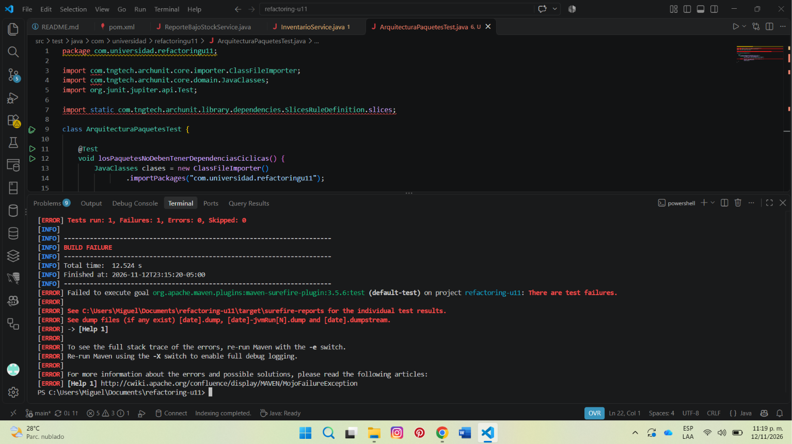

#### 2.4. Verificación de las pruebas funcionales

Se ejecutaron nuevamente las pruebas de caracterización de `InventarioServiceTest`, `ClasificadorProductoTest` y `EtiquetadoProductoTest`, sin modificar sus implementaciones.

Estas pruebas verifican el comportamiento funcional del inventario de manera independiente de la regla de arquitectura.

Su ejecución satisfactoria demuestra que el sistema puede conservar el comportamiento esperado aun cuando su organización interna presente dependencias no deseadas.

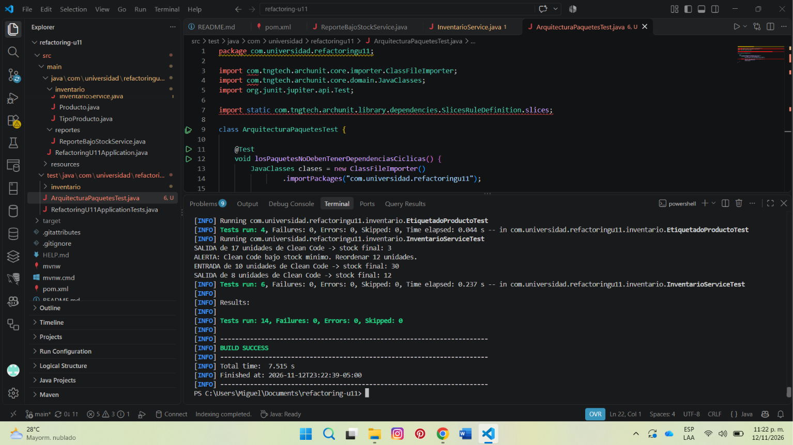

#### 2.5. Conclusión del diagnóstico

La comparación entre las pruebas funcionales y la prueba de arquitectura permite establecer que un sistema puede compilar correctamente y superar sus pruebas de negocio, sin que esto garantice una arquitectura libre de problemas de diseño.

El ciclo entre `inventario` y `reportes` constituye un problema de acoplamiento bidireccional que aumenta la dependencia entre módulos y dificulta su mantenimiento.

En el siguiente paso se aplicará el principio de Inversión de Dependencias mediante la interfaz `NotificadorBajoStock`, ubicada en el paquete `inventario`, con el propósito de eliminar el ciclo sin modificar el comportamiento observable del sistema.


Para verificar el estado local del proyecto:

```bash
mvn test
git log --oneline -5
git status
```


